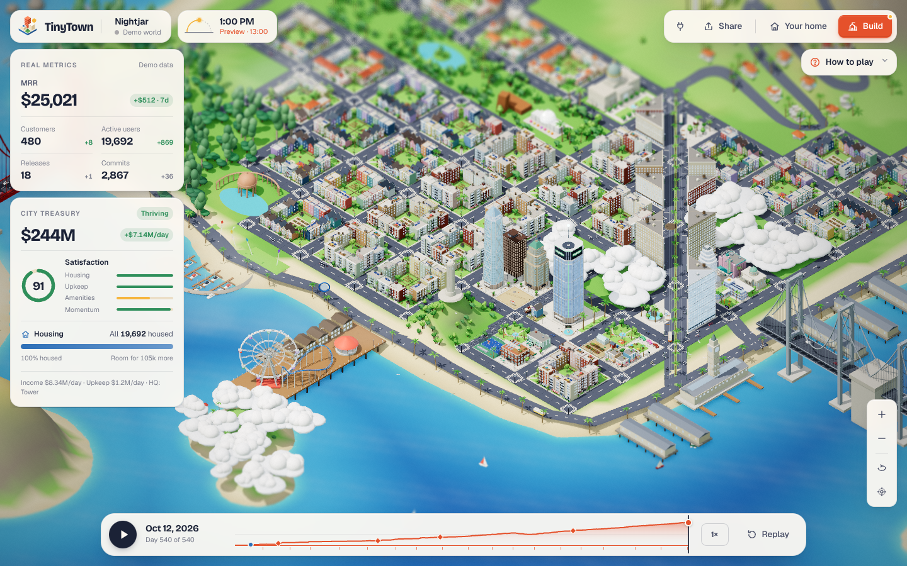
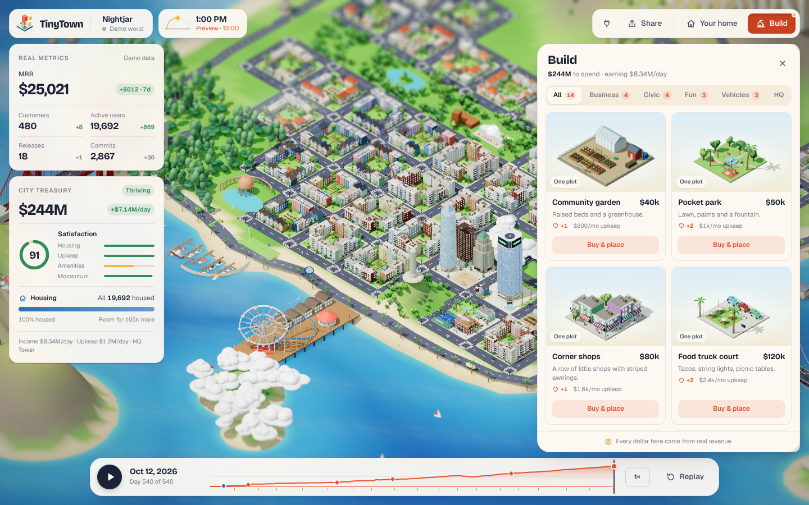
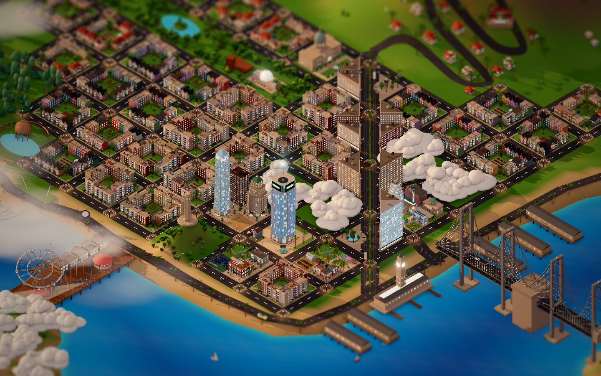
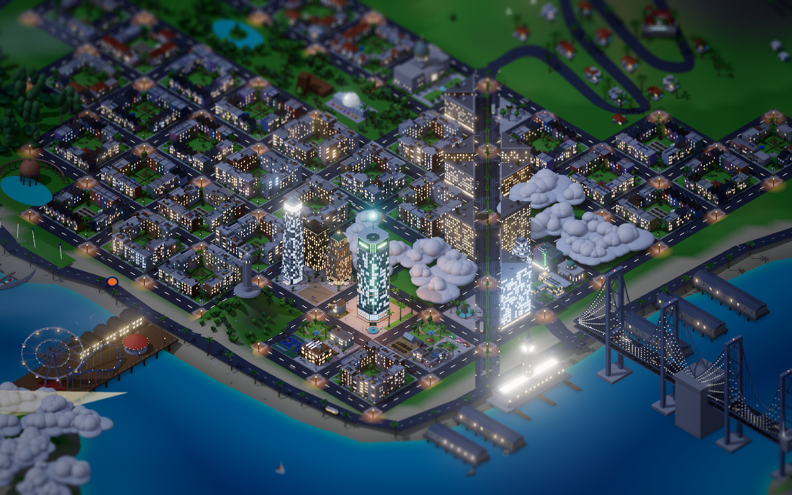
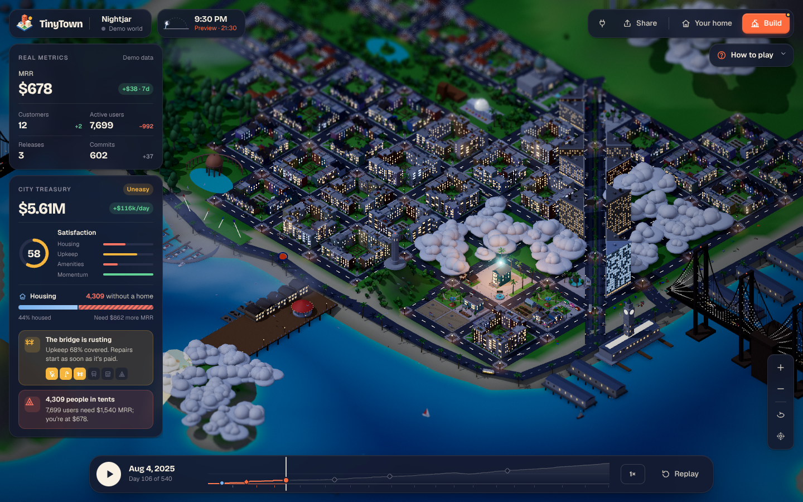
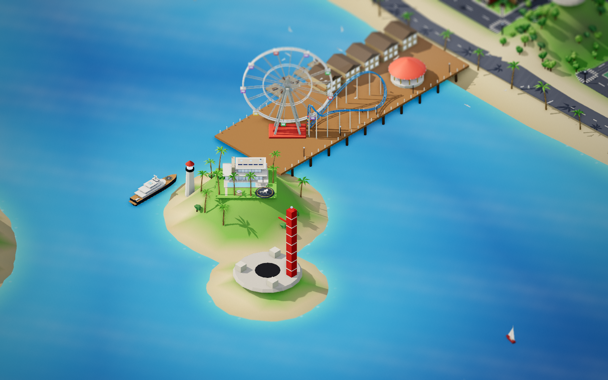

# TinyTown

**Your startup, as a city you build.** Every real dollar of revenue becomes $10,000 to spend on your city: offices, parks, towers, a stadium, a university, planes, a rocket. Your users live there, and housing them costs money, so if your conversion rate is too low people end up homeless and the city runs down. Every extra digit of MRR moves you into a better house, from a hacker house to the Hills to your own island to the moon.

**The only way to grow your city is to grow your startup.** Nothing in the game makes money, and you can't buy currency.

The world is a toy-sized **San Francisco Bay**, laid out like the real thing: downtown and the Financial District on the north-east corner of the peninsula, Market Street cutting diagonally to Civic Center and City Hall's gold dome, the Embarcadero and its piers, the Marina, the Presidio's forest and the Golden Gate to the north-west, Golden Gate Park and the Sunset running out to Ocean Beach, the Bay Bridge to Treasure Island and Oakland, and SFO down the peninsula. Painted ladies, Sunset stucco row houses and Edwardian flats fill the neighbourhoods; a Transamerica pyramid and a Salesforce-style spire rise as you grow. The city is alive: cars, Muni buses and cabs on a real street grid, people on the sidewalks, F-line streetcars and cable cars, ferries and sailboats on the bay, airliners landing at SFO, gulls, kites and the Karl the Fog rolling in. A **TINYTOWN** sign sits on the hill above it all.





## Day and night

The sun follows **your local clock**. Mornings are soft, middays are bright, golden hour is long, and at night the windows, street lamps, neon, bridge lights and the floodlit sign come on. The chip next to your startup's name shows the time; click it to preview morning, midday, golden hour and night, then click again to go back to live. Add `?time=19:30` (or `7pm`) to the URL to pin a time, which is handy for recording.

<p>
  
  
</p>

## Try it

```bash
npm install
npm run dev          # http://localhost:5173 — the demo world replays 18 months of a fictional startup
```

The demo replays 540 days of a made-up startup called *Nightjar*, including what its founder built along the way: first customer, a launch-day rush of free users that outruns revenue (tents, a dark sign, a rusting bridge), recovery, then a skyline. Jump in at any point and build your own way; your choices are saved in this browser. `/?demo&fresh` resets to the scripted founder, and `/?demo&boost=40` multiplies the demo by 40 so you can see the island, launch site and $1B-a-month projects.

Drag to pan, right-drag or <kbd>Q</kbd>/<kbd>E</kbd> to rotate, scroll or <kbd>+</kbd>/<kbd>−</kbd> to zoom, <kbd>B</kbd> to build, <kbd>Space</kbd> to play or pause. Hover over anything to see what it is; click an empty plot to build on it.

## How the game works

The full design, with every number, is in [docs/GAME_DESIGN.md](docs/GAME_DESIGN.md).

| | |
| --- | --- |
| **Money** | Every real $1 of revenue is $10,000 in your treasury, paid daily. At $100k MRR your city earns $1B a month. |
| **Build** | Offices, parks, shops, a library, theatres, towers, a stadium, a university, a venture studio, a supertall, pier rides, yachts, planes and a rocket, each unlocked at an MRR tier. HQ upgrades from a garage to a landmark tower. |
| **Housing** | Your active users live in the city. Each needs $0.20 of MRR to be housed (1,000 users need $200 MRR). Below that, people end up in tents and the city runs down. |
| **Upkeep and decay** | Buildings cost upkeep. When it isn't covered, the TINYTOWN sign goes dark first, then street lamps fail, the bridge rusts, the train stops and shops board up. Nothing is destroyed, and it all recovers when money comes back. |
| **Land** | Clouds cover what you haven't unlocked. New downtown blocks open once you've built on every plot *and* MRR reaches the next gate. The Hills, pier, marina, your island and its launch site open at MRR milestones. |
| **Your home** | Hacker House → studio ($10) → bungalow or loft ($100) → a TinyTown Hills house ($1k) → pick one of three estates ($10k) → island estate and superyacht ($100k) → a house on the moon ($1M; buy a rocket to visit). |
| **Satisfaction** | 0–100 from housing, upkeep, amenities and MRR growth. No in-game action can raise it except growing the business. |
| **Free infrastructure** | Roads, the train, the bridge and the airport. Planes are what you buy. |

Real metrics still drive the world, as before: HQ gains a floor per GitHub release, the train speeds up with commits, and rain falls when MRR drops more than 1% in a week.

<p>
  
  
</p>

## Connect your startup

API keys stay on a small server you run. They never reach the browser.

```bash
cp .env.example .env   # then fill in what you have
npm run build
npm start              # http://localhost:8787
```

| Variable | |
| --- | --- |
| `TINYTOWN_NAME` | The name on your HQ's neon sign. |
| `STRIPE_SECRET_KEY` | A **restricted** key with read-only access to *Subscriptions*. Don't use a full secret key. |
| `GITHUB_REPO` | `owner/repo`. Its releases and default-branch commits drive your HQ. |
| `GITHUB_TOKEN` | Only needed for private repos: a fine-grained token with read-only *Contents*. |

Both integrations are optional. With neither configured, the app runs the demo. A live world opens on today's state; press **Replay** (or open `/?replay`) to watch your whole history play out. `/?demo` forces the demo world.

For development against live data, run `npm run dev:server` and `npm run dev` side by side. Vite proxies `/api` to the server.

**How history is rebuilt.** On first connect, Stripe history comes from each subscription's start, trial-end and end dates, so you see your town from day one. MRR uses each subscription's current prices: discounts and mid-period plan changes aren't modelled, and only your most common currency is counted. GitHub history covers your last 1,000 commits and 500 releases.

## Sharing

**Share** captures the current view as a PNG with your startup's name and day number on it. Metrics stay out of the image unless you tick the box. Download it, or copy it straight to the clipboard to post it.

## How it's built

```
Stripe / GitHub ──► server/        fetch + cache (60s), keys stay here
                     │
                     ▼
              src/data/            Stripe, GitHub → one Snapshot per day (pure)
                     │
                     ▼
              src/world/           Snapshot → WorldPlan (pure, deterministic)
                     │             two days → WorldEvents (joins, unlocks, releases, rain)
                     ▼
              src/render/          three.js: reconcile scene against the plan, animate events
              src/ui/              metrics panel, legend, timeline, share
```

- **Deterministic.** The same numbers always produce the same city, seeded by your startup's name. Growth only ever adds to it, so customer #12's house never moves when #13 arrives.
- **Cheap to render.** However detailed a building is, it's merged into a handful of meshes by material (matte, glass, smooth, lights). Every home in the city shares one `BatchedMesh` per material, and cars, people, gulls, lamps and trees are instanced, so a fully grown city with shadows draws in about 750 calls (the target is a few hundred; see `docs/TODO.md`). Quality adapts to the device (`?quality=low|medium|high` to force it).
- **Miniature look.** A post pipeline renders the city like a model you could pick up: ambient occlusion for contact shadows, bloom only on lights after dark, a tilt-shift blur at the top and bottom of the frame, and a warm filmic grade.
- **Reconciled, not rebuilt.** A new day diffs the plan and touches only what changed: one customer costs one small house.
- **No backend dependencies.** The server is plain Node (≥ 22.18, which runs TypeScript directly) plus `fetch`.

```bash
npm test             # planner, events, weather, Stripe/GitHub aggregation, static-file safety
npm run typecheck
```

## Working on TinyTown

Start with [`CLAUDE.md`](CLAUDE.md) and [`docs/HANDOFF.md`](docs/HANDOFF.md), which hold the whole history, decisions and current state. Then read [`docs/TODO.md`](docs/TODO.md) (backlog), [`docs/ARCHITECTURE.md`](docs/ARCHITECTURE.md) (code map) and [`docs/DEV_WORKFLOW.md`](docs/DEV_WORKFLOW.md) (running, testing and screenshots). To hand the project to a new Claude Code cloud session, paste the prompt in [`docs/NEXT_SESSION_PROMPT.md`](docs/NEXT_SESSION_PROMPT.md).

## Roadmap

From [the product thesis](docs/PRODUCT.md), in priority order:

1. **Ship one world exquisitely.** More hand-made detail in the Bay, sound, and celebration moments people want to record.
2. **Public world page.** An opt-in URL for your city, with metrics hidden by default.
3. **Growth recap video.** Export the replay as a 15-second clip for posting.
4. **PostHog** (active users become people on the streets) and **Supabase** (signups).
5. **Desktop mode.** A small always-on window or wallpaper.
6. **Themes**, only once people have shown they care about the first one.
