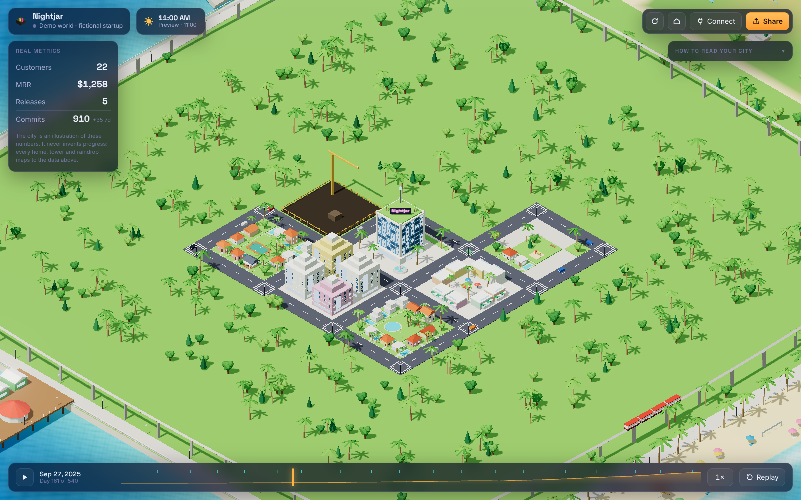
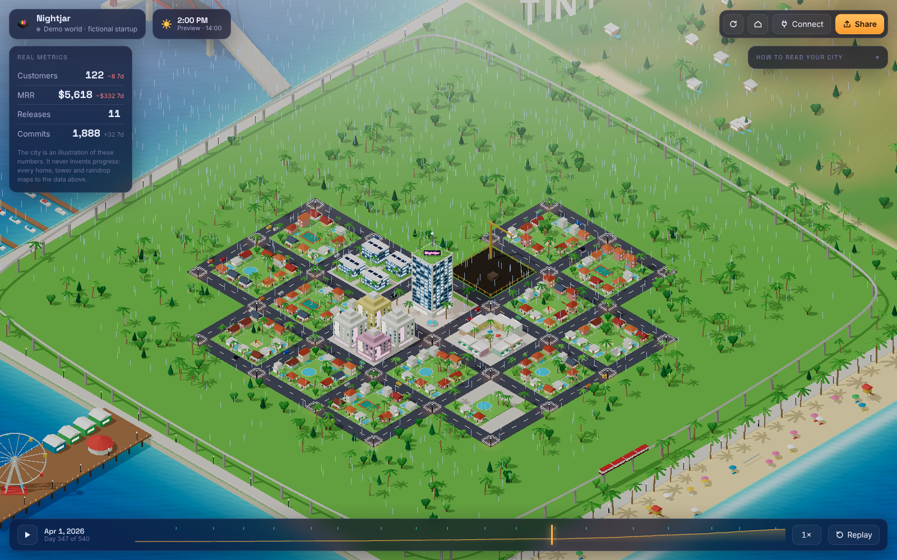

# TinyTown

**Your startup, as a living world.** A little isometric city that grows with your company's real metrics. Every paying customer moves into a house, revenue milestones open new districts, every release adds a floor to your HQ, and a rough week brings rain.

It isn't a dashboard and it isn't a chatbot. It's something you've built, shown as a small world.

The world is **Golden Coast**, a sunny cross between San Francisco and Los Angeles: painted-lady terraces and Spanish stucco under terracotta roofs, palms, glass towers, a red suspension bridge over the bay, a pier with a Ferris wheel, a beach, and a **TINYTOWN** sign on the hill behind it all.


## Day and night

The sun follows **your local clock**. Mornings are soft, middays are bright, golden hour is long, and at night the windows, street lamps, neon, bridge lights and the floodlit sign come on. The chip next to your startup's name shows the time; click it to preview morning, midday, golden hour and night, then click again to go back to live. Add `?time=19:30` (or `7pm`) to the URL to pin a time, which is handy for recording.

<p>
  
  
</p>

## Try it

```bash
npm install
npm run dev          # http://localhost:5173 — the demo world replays 18 months of a fictional startup
```

The demo replays 540 days of a made-up startup called *Nightjar*: first customer, public launch, steady growth, one bad stretch, then a skyline. Drag to pan, right-drag or <kbd>Q</kbd>/<kbd>E</kbd> to rotate, scroll to zoom, <kbd>Space</kbd> to play or pause. Hover over anything to see what it stands for.

## How to read your city

The world is a pure function of your numbers. The panel on the left always shows the real values behind it.

| You see | It means | Source |
| --- | --- | --- |
| A home | One paying customer. Ten homes make a neighbourhood. When all 400 lots are full, homes become townhouses and then apartments, and the legend tells you how many customers each one houses. | Stripe |
| A new district | MRR reached a milestone: first revenue, $1k, $5k, $10k, $25k, $50k, $100k, $1M. | Stripe |
| A district that stays dark after sunset | MRR has dropped back below that district's milestone. Districts you've earned stay built. | Stripe |
| A fenced lot with a crane | The next milestone. Hover over it to see the target. | — |
| HQ floors | One floor per GitHub release, plus fireworks on release day. | GitHub |
| The beacon flaring, the train sprinting | Commits pushed. The train's cruising speed follows your last 7 days of commits. | GitHub |
| Rain and overcast skies | MRR fell more than 1% over the trailing week. It clears once the week is flat or up. | Stripe |
| Cars on the road | Traffic grows with your customer count. | Stripe |

TinyTown never shows fictional progress. Nothing in the city grows unless one of these numbers changed.

<p>
  
  
</p>

## Connect your startup

API keys stay on a small server you run. They never reach the browser.

```bash
cp .env.example .env   # then fill in what you have
npm run build
npm start              # http://localhost:8787
```

| Variable | |
| --- | --- |
| `TINYTOWN_NAME` | The name on your HQ's neon sign. |
| `STRIPE_SECRET_KEY` | A **restricted** key with read-only access to *Subscriptions*. Don't use a full secret key. |
| `GITHUB_REPO` | `owner/repo`. Its releases and default-branch commits drive your HQ. |
| `GITHUB_TOKEN` | Only needed for private repos: a fine-grained token with read-only *Contents*. |

Both integrations are optional. With neither configured, the app runs the demo. A live world opens on today's state; press **Replay** (or open `/?replay`) to watch your whole history play out. `/?demo` forces the demo world.

For development against live data, run `npm run dev:server` and `npm run dev` side by side. Vite proxies `/api` to the server.

**How history is rebuilt.** On first connect, Stripe history comes from each subscription's start, trial-end and end dates, so you see your town from day one. MRR uses each subscription's current prices: discounts and mid-period plan changes aren't modelled, and only your most common currency is counted. GitHub history covers your last 1,000 commits and 500 releases.

## Sharing

**Share** captures the current view as a PNG with your startup's name and day number on it. Metrics stay out of the image unless you tick the box. Download it, or copy it straight to the clipboard to post it.

## How it's built

```
Stripe / GitHub ──► server/        fetch + cache (60s), keys stay here
                     │
                     ▼
              src/data/            Stripe, GitHub → one Snapshot per day (pure)
                     │
                     ▼
              src/world/           Snapshot → WorldPlan (pure, deterministic)
                     │             two days → WorldEvents (joins, unlocks, releases, rain)
                     ▼
              src/render/          three.js: reconcile scene against the plan, animate events
              src/ui/              metrics panel, legend, timeline, share
```

- **Deterministic.** The same numbers always produce the same city, seeded by your startup's name. Growth only ever adds to it, so customer #12's house never moves when #13 arrives.
- **Cheap to render.** However detailed a building is, it's merged into at most two meshes: one lit, one emissive. Roads, lamps and cars are instanced. A fully grown city, shadows and bloom included, takes under 900 draw calls a frame. Bloom picks up only the windows and neon.
- **Reconciled, not rebuilt.** A new day diffs the plan and touches only what changed: one customer costs one small house.
- **No backend dependencies.** The server is plain Node (≥ 22.18, which runs TypeScript directly) plus `fetch`.

```bash
npm test             # planner, events, weather, Stripe/GitHub aggregation, static-file safety
npm run typecheck
```

## Roadmap

From [the product thesis](docs/PRODUCT.md), in priority order:

1. **Ship one world exquisitely.** More hand-made detail in Golden Coast, sound, and celebration moments people want to record.
2. **Public world page.** An opt-in URL for your city, with metrics hidden by default.
3. **Growth recap video.** Export the replay as a 15-second clip for posting.
4. **PostHog** (active users become people on the streets) and **Supabase** (signups).
5. **Desktop mode.** A small always-on window or wallpaper.
6. **Themes**, only once people have shown they care about the first one.
